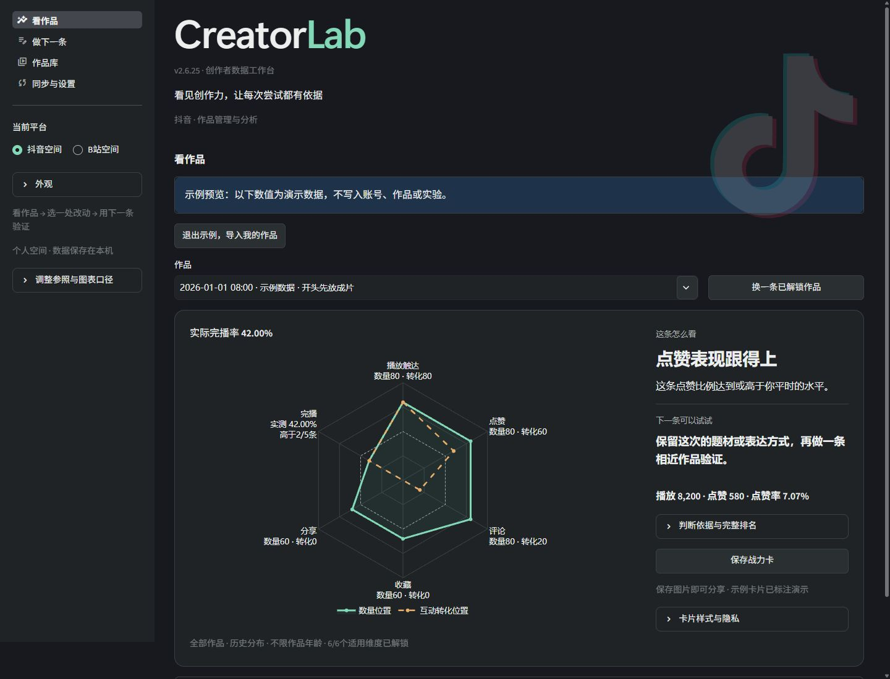

# CreatorLab · 创作者数据工作台

**2.6.31 Beta｜看见创作力，让每次尝试都有依据。**

面向中文个人创作者的本地工作台，聚焦抖音与B站。先看作品的真实表现，再选择一处改动，用后续作品复盘。当前不提供团队／MCN分区。平台页面变化、登录和验证可能影响采集；实际验证范围见[发布检查](docs/RELEASE_CHECKS.md)。



截图来自内置示例页面，不含个人账号数据，不代表真实作品表现、行业基准或全站排名。

## 三步上手（Windows）

1. **打开工作台**：安装64位Python 3.12（包含Python Launcher），解压源码，双击 `start_windows.bat`。首次需要联网安装依赖。
2. **先看示例或导入作品**：示例无需登录；正式使用到「同步与设置」添加账号。抖音可只填昵称，同步后核对归属；B站填写UID。
3. **看懂一条，再做下一条**：在「看作品」读图与结论，再进入「做下一条」选择一处改动、记录并复盘。

具体步骤与常见卡点见[第一次使用](docs/FIRST_RUN.md)。

平时运行相同脚本，保持启动窗口打开；Ctrl+C退出。依赖正常时不重复安装，在线采集与云端AI仍需网络。修复依赖用 `repair_windows.bat`，恢复数据用 `recover_windows.bat`。

## 四个入口

| 入口 | 主要用途 |
| --- | --- |
| 看作品 | 战力图、直观结论与PNG；详细报告、作品对比、外部参照按需展开 |
| 做下一条 | 有证据的创作建议、本地视频检查、实验与复盘 |
| 作品库 | 搜索、筛选、分类、作品报告及导出 |
| 同步与设置 | 同步作品、确认归属、自动更新、备份恢复与帮助 |

B站空间的「看作品」顶部可直达「每周必看」，按标签、期数或发布时间筛选 100 期精选样本。详见[精选库使用说明](docs/WEEKLY_REFERENCE.md)。

「做下一条」可从选中的作品带入创作方案，再将一次改动关联后续作品。见[阶段4—6指南](docs/CREATIVE_WORKFLOW.md)。

同步区顶部统一显示已入库数量、待确认的新作品、最近入库更新时间与下一步操作；读取数量不再混称入库数量。技术信息收在任务详情中。

## 支持范围

| 能力 | 抖音 | B站 |
| --- | --- | --- |
| 作品导入与原始指标 | 本人创作者中心，需登录及归属核对 | 按UID读取公开投稿，部分流程可能需要验证 |
| 战力图、筛选与PNG | 支持，依赖有效历史样本 | 支持，使用B站独立指标 |
| 完播与阅读深度 | 来源提供时使用；图文单独处理 | 公开投稿通常无完播率，不估算 |
| 已入库作品定时更新 | 可选开启，服务需保持运行 | 暂未接入 |
| 每周必看外部参照 | 不使用B站样本 | 可筛选，有来源与样本限制 |
| 创作建议与实验复盘 | 支持；AI默认关闭 | 支持；不合并两平台评分 |

Windows已做本机独立环境安装与首次使用验收。macOS、Docker、付费模型和长期在线运行的验证边界单列在[发布检查](docs/RELEASE_CHECKS.md)，不以功能入口存在代替验收。

## 同步与自动更新

- **抖音首页同步**：已有账号读取管理首页这一批，新增或归属不明的作品需要确认；首次空库完整导入。首页之外漏采需手动完整扫描。
- **抖音自动更新已有作品**：在「自动更新已入库作品」中启用并保存一次，默认每天一次，可选每6／12小时。只更新已经核对、ID归属唯一的已有作品，不导入新作品。
- **保持服务运行**：网页可关闭；退出启动窗口或电脑关机后不安排下一轮，正在执行的一轮可能完成。登录失效或验证码时暂停，先手动处理再恢复。详见[自动更新指南](docs/AUTO_UPDATE.md)。
- **B站**：支持公开投稿导入及补采；当前没有上述后台定时更新入口。公开视频通常不提供完播率，不估算。

本轮真实在线检查和跨天观察进度单列在[实际验证](docs/LIVE_VALIDATION.md)。本地测试通过不代表所有账号、所有网络和长期后台运行均已验收。

## 数据与指标规则

- 默认参照同账号、同平台的全部其他有效历史作品，不自动按体裁、年龄或赛道缩小范围。同赛道对比须主动选择并人工分类。
- 保留数量实线、互动转化虚线；图文使用独立阅读深度，不套用视频完播率。
- 缺失不补零，小样本高比例不获得虚高评分。各指标使用自己的有效样本和观测时间。
- 每周必看100期库是精选外部样本，不代表全站用户；来源与限制见[参照说明](docs/WEEKLY_REFERENCE.md)。
- 累计值不能回推错过的24小时／7天／30天窗口；相关性不等于因果，不保证增长。

## 本地数据与AI

个人数据默认保存在 `local/`，包括数据库、工作流附属库、封面、备份与浏览器登录会话。**不要上传或分享整个工作目录；使用[公开发布流程](docs/PUBLISHING.md)生成干净源码包。** 迁移时先关闭程序并自行备份完整个人目录，避免只保留主库而丢失附属记录。

模型默认关闭。DeepSeek／豆包等需用户自行配置，预览发送内容并明确同意后才调用，可能产生供应商费用，见[中文配置](docs/AI_CN.md)。本地视频检测不持久保存原视频；可选AI入口见[视频检查指南](docs/VIDEO_INSPECTION.md)。

## 开发与验证

```bash
python3.12 -m venv .venv
# 激活虚拟环境后
python -m pip install -r requirements-dev.txt
python -m pytest -q
python tools/release.py
python -m streamlit run app.py
```

Windows/Linux Python 3.12 CI配置已提供；远端执行结果以真实运行记录为准。macOS和Docker没有本轮实机验收；Docker只提供分析与文件导入，不运行浏览器采集。默认服务仅监听本机，不作为公开云服务部署。

[当前验证范围](docs/RELEASE_CHECKS.md) · [公开发布](docs/PUBLISHING.md) · [更新记录](CHANGELOG.md)

## 问题与建议

仓库发布后，使用 **Issues → New issue** 中的「使用问题」或「改进建议」模板。请提供版本、系统、复现步骤和预期／实际结果；不要上传数据库、登录会话、密钥或原始日志。截图先遮挡个人信息，诊断使用应用内生成的脱敏报告。

[反馈与参与说明](docs/CONTRIBUTING.md) · [使用与排障](docs/USAGE.md) · [全部文档](docs/README.md) · [历史升级记录](docs/history/README.md)

项目代码采用MIT。字体、图标与项目技能分别保留各自作者与许可证，见[第三方资源](docs/THIRD_PARTY.md)。历史版本说明位于 `docs/history/`，当前行为以本页与当前指南为准。
